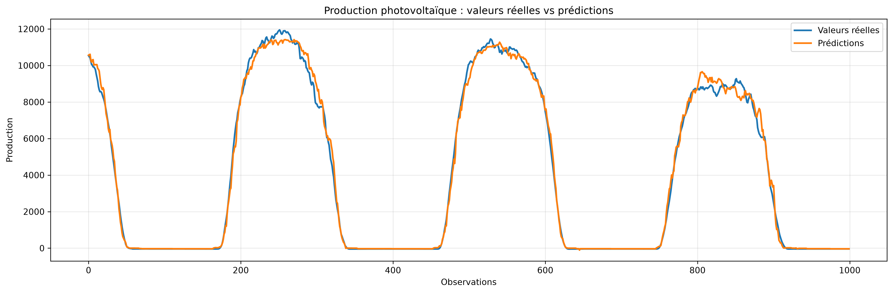

# ⚡ Smart Energy Forecasting - Prévision H+1 & aide à la décision climat-énergie

> Projet de fin d'études - Master 2 Informatique EI2D (Exploration Informatique des Données et Décisionnel) Université Sorbonne Paris Nord & Master Data Science (USMBA, Fès) · Juin–Septembre 2026

**En une phrase :** un pipeline complet (données → modèles → dashboard Power BI → application Streamlit) qui prévoit à 1 heure la production photovoltaïque, éolienne et la demande électrique, puis simule l'effet de scénarios climatiques sur la couverture renouvelable.

## Démo Streamlit : <(https://smartenergyforecasting-64acjhxamuzmngjy35ucdt.streamlit.app/)>



---

## Le problème métier
Les énergies renouvelables dépendent de la météo. Un gestionnaire de réseau doit anticiper, à court terme, ce que produiront le solaire et l'éolien et ce que consommeront les clients, et, à plus long terme, mesurer la sensibilité de cet équilibre au climat.

## Résultats clés
| Cible | Modèle retenu | RMSE test | R² test | Gain RMSE vs baseline (J-1) |
|---|---|---:|---:|---:|
| Photovoltaïque | HistGradientBoosting | ≈ 470 | ≈ 0,99 | **51,7 %** |
| Éolien | Régression linéaire | ≈ 264 | ≈ 0,95 | **78,1 %** |
| Demande électrique | HistGradientBoosting | ≈ 272 | ≈ 0,997 | **85,5 %** |

- **Hausse de température à Fès : +0,486 °C / décennie** (1990–2025, p = 0,0001) ; ≈ +1,38 °C entre 1990-1999 et 2016-2025.
- **Scénario le plus défavorable (+2 °C, −10 % de rayonnement) :** couverture renouvelable de **21,21 % → 19,91 %**, soit un effort d'adaptation théorique de **6,58 %**.
- **Honnêteté méthodologique :** sur l'éolien, le gain devient quasi nul en Allemagne (≈ 1,3 %) et négatif au Maroc (≈ −3 %). Ce résultat est volontairement conservé : le modèle n'est jamais re-sélectionné après avoir vu le test.

## Ce qui rend l'évaluation crédible
- Découpage **chronologique** 70 / 15 / 15, aucun mélange aléatoire, test final isolé.
- **Baseline saisonnière** (valeur de la veille) : un R² élevé seul ne prouve rien, il faut battre la baseline.
- **Walk-forward** sur 3 fenêtres pour mesurer la stabilité dans le temps.
- **Validation externe** : Allemagne (OPSD) et Maroc (Zenodo), modèles réentraînés.
- Cibles H+1 construites sans fuite d'information (`shift(-12)` sur pas de 5 min).

## Données
| Source | Contenu | Usage |
|---|---|---|
| Mendeley Data (CAISO / NREL) | 315 648 observations à 5 min, 2019–2021 : production PV, éolien, demande, météo | Modélisation principale |
| NASA POWER | Climat de Fès, 1990–2025 | Tendances & scénarios |
| Open Power System Data | Allemagne, horaire | Validation externe |
| Zenodo (Johnson, 2025) | Maroc 2015, facteurs de capacité modélisés | Transférabilité |

## Stack
Python (pandas, NumPy, scikit-learn, Plotly) · Streamlit · **Power BI** · Jupyter · Git

## Structure
```
notebooks/   01 audit → 10 climat & aide à la décision
app/         application Streamlit
powerbi/     tableau de bord (.pbix + export PDF)
results/     métriques et tables de résultats (CSV)
figures/     visualisations
models/      modèles entraînés (.pkl)
```

## Lancer le projet
```bash
pip install -r requirements.txt
streamlit run app/app.py
```
Exécuter ensuite les notebooks dans l'ordre `01` → `10`.

## Limites 
Horizon H+1 uniquement · période commune climat/énergie de 164 jours (corrélations ≠ causalité) · vent mesuré à 10 m (peu représentatif d'une turbine) · scénarios de **sensibilité**, pas des projections GIEC · Maroc : facteurs de capacité modélisés, pas des mesures · prototype sur données historiques, pas de temps réel.

## Auteure
**Célestine LENO** - Data Analyst · [LinkedIn](https://www.linkedin.com/in/celestineleno) · celestinesialeno@gmail.com
